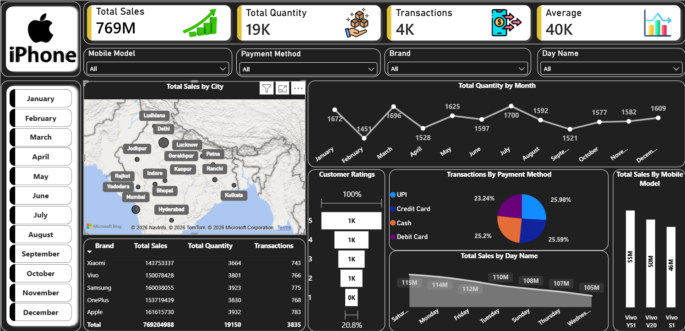

# Mobile-Sales-Dashboard-

# Mobile Sales Dashboard

## Overview
An interactive Power BI dashboard that analyzes mobile phone sales across
5 brands (Apple, Samsung, OnePlus, Vivo, Xiaomi), multiple Indian cities,
payment methods and time periods.

## Objective
To track sales performance, understand customer buying patterns, and identify
top brands, top models and the best-performing days and months.

## Key Metrics (KPIs)
| Metric | Value |
|---|---|
| Total Sales | 769M |
| Total Quantity | 19K units |
| Transactions | 4K |
| Average Sales | 40K |

## Dashboard Features
- City-wise sales on a map
- Monthly quantity trend
- Brand-wise sales, quantity and transactions
- Transactions by payment method
- Sales by day of the week
- Top mobile models by sales
- Customer ratings breakdown
- Slicers for Month, Mobile Model, Payment Method, Brand and Day Name

## Dashboard Preview

## Key Insights
- Apple leads in total sales (~161.6M), closely followed by Samsung (~160M).
- Xiaomi has the lowest sales among the 5 brands (~143.8M).
- July has the highest quantity sold (1,700 units), while February is the lowest (1,451).
- Payment methods are almost evenly split: UPI (25.98%), Credit Card (25.59%),
  Cash (25.2%) and Debit Card (23.24%).
- Saturday has the highest sales (115M) and Wednesday the lowest (105M).
- Vivo Y51 is the top-selling model (55M), followed by Vivo V20 (50M) and Vivo S1 (46M).

## Tools Used
- Power BI (DAX, Slicers, Maps, Charts)

## Files
- `Mobile_Sales_Dashboard.pbix` : Power BI dashboard file
- `Dashboard.png` : dashboard screenshot
